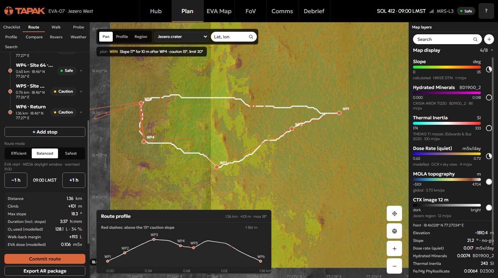

<p align="center">
  
</p>

<h1 align="center">TAPAK: A Physiology-Aware Route Planner for Crewed Surface Excursions on Mars</h1>




TAPAK is a route planner for single crewed surface excursions on Mars. It pairs stochastic route planning with Damon, a biomechanical walking model fine-tuned from KINESIS for Martian conditions. Users set a base, science goals, and mission limits, and the app returns an optimized route with an oxygen budget, radiation dose, walk-back margin, and an explained GO, CAUTION, or NO-GO verdict. To model Jezero Crater, TAPAK layers multiple NASA datasets: a 1-meter HiRISE terrain model and orthoimage, Perseverance MEDA temperature and pressure records, and a galactic cosmic ray dose model scaled by sky view. Its core contribution is a physics-derived walking cost. Because standard energy models rely on unsuited humans in Earth gravity, TAPAK replaces them with costs learned from musculoskeletal simulations. Driven by the fine-tuned policy via reinforcement learning, an 80-muscle leg model traverses synthetic terrain patches under Mars gravity and spacesuit mass. A gradient-boosted surrogate then translates these results into per-step energy expenditure, fall probability, and stability metrics for the route search.


## Run it

```bash
npm install
npm run dev        # http://localhost:5173
npm run build      # type-check + production build in dist/
npm run preview    # serve the production build
```

Requires Node 20 or newer. The build uses a relative base path, so `dist/` can be hosted from any folder (for example GitHub Pages).

## Add the images first

One raster placeholder is still **not in this repository**; export it from Figma and save it here:

| File | Figma layer | Used on |
| --- | --- | --- |
| `public/images/mars-globe.png` | "Mars globe (placeholder image)" | Comms · Pass prediction |

Plan, EVA Map, FoV and Debrief now use the real HiRISE orthoimage and DTM in `public/data/terrain/`, so
`mars-basemap.jpg` and `fov-camera.jpg` are no longer needed.

Until it exists, the slot shows a neutral surface and a status line naming the missing file. Check the license and credit of the image before the submission; the design marks it as a placeholder to be replaced with real NASA imagery.

## Screens

| Route | Figma frame |
| --- | --- |
| `/` (no hash) | TAPAK landing page (screenshots in `public/landing/`) |
| `#/hub` | 01 · Mission Hub (Pre-EVA) |
| `#/plan` | 02 · Route Planner (Pre-EVA) |
| `#/eva` | 03 · EVA Map (During EVA) |
| `#/fov` | 04 · FoV Simulation (During EVA) |
| `#/comms` | 05 · Comms · Link Budget |
| `#/comms/passes` | 06 · Comms · Pass Prediction |
| `#/debrief` | 07 · Debrief (Post-EVA) |

A guided tour (`src/tour/`) walks through each screen the first time it opens; progress is kept in local storage and it can be skipped.

The app renders a fixed 1366 × 1024 stage (iPad Pro 12.9" landscape) and scales it to fit the window.

## Stack

- Vite, React 19, TypeScript (strict)
- Tailwind CSS v4, with the Marswalk tokens declared in `src/index.css`
- shadcn/ui conventions (`components.json`, `src/components/ui`, `cn`, `cva`, Radix primitives): Button, Badge, Card, Checkbox, Dialog, Input, ToggleGroup, all restyled with Marswalk tokens
- Geologica and Urbanist, bundled through Fontsource so the app works offline

## Structure

```
src/
  index.css               design tokens (colors, spacing, radius, type styles, ramps)
  styles/motion.css       motion tokens and every animation pattern
  lib/                    motion helpers, hash router, session store
  data/mission.ts         all demo data (synthetic), one place to swap for real data
  components/ui/          shadcn-style primitives
  components/marswalk/    product components (top bar, checklist, map, alerts, comms...)
  screens/                one file per Figma screen, plus the landing page
  engine/                 science engine, models, light-time link sync
  sim/                    typed adapters, FoV, AR package export
  tour/                   guided tour
api/                      Vercel functions: /link relay, /ar-comms
backend/                  Flask API: comms passes, link budget, Hub checklist
docs/                     integration, provenance, AR package, release notes
```

Design rules come from two project documents: `DESIGN.md` (look) and `DESIGN-MOTION.md` (movement). Components use semantic tokens only; durations and easings live in `motion.css` and are read from CSS variables in JS.

## Motion

Stepped, frame-snapped motion in 50 ms ticks. The map camera is the only smooth movement.

| Pattern (DESIGN-MOTION.md) | Where |
| --- | --- |
| Flash-in, staggered in reading order | rows, tiles, timeline bars, candles, panels |
| Header wipe | every panel header |
| Lock-on open | site panel on Pass prediction (tap the "You" marker) |
| Hover underline then fill, press inversion | buttons and nav tabs |
| Hold to confirm | "Commit route" (keyboard users get a confirm dialog) |
| Text decode | screen headings and status lines |
| Stepped readout ticker | stat rows and metric tiles when a value changes (heart rate on EVA Map) |
| Layer scan reveal | layer toggles on Plan, sky-dome wedges |
| Route draw | planned and walked routes, elevation profiles |
| Hazard interrupt | hazard alert and the blocked segment, readable on frame one |
| Verdict stamp | verdict banner on Plan |
| Screen change | six columns between views, top bar stays put |
| Status line (toast) | commit, sync, missing images |
| Selection brackets | active checklist step, selected waypoint, relay in view |

Reduced motion: with the OS setting, or `?motion=reduced` in the URL, every sequence becomes a single 100 ms fade.

Not built yet: directional ticks, pixel-stair loader, and the in-app reduced-motion switch.

## Science engine

Routes, oxygen, dose, weather, walk-back and the GO / CAUTION / NO-GO verdict are computed by the Marswalk science
engine in `src/engine/` on real Jezero data (HiRISE DTM and orthoimage, MEDA weather, Perseverance stops) in
`public/data/`. Typed adapters in `src/sim/` feed the screens. See [docs/INTEGRATION.md](docs/INTEGRATION.md) and
[docs/SCIENCE_PROVENANCE.md](docs/SCIENCE_PROVENANCE.md).

```bash
npm test           # engine, FoV, AR package, link/comms API and tour tests
npm run typecheck  # tsc strict
npm run test:e2e   # comms end-to-end (Node and Python)
```

CI (`.github/workflows/ci.yml`) runs typecheck, tests and build on every PR and on `main`.

```bash
```

## Backend

`backend/` is a Flask API that serves `GET /comms/passes` and `GET /comms/link`, computed from relay orbits and a UHF
link budget, and stores the Hub checklist in Turso (see `.env.example`). Start it, then set `VITE_MARSWALK_API_URL=http://localhost:5000` in `.env.local` (see `.env.example`).
Without it, the Comms screens use their dummy data. See [backend/README.md](backend/README.md).

## Live link to the Marswalk AR phone app

Committing a route (Plan → **Commit route**) sends it over the light-time link; the Marswalk AR app (Unity, ARCore /
ARKit) loads it, acks, and sends a status every 2 s that drives the mission clock, so EVA Map, FoV and telemetry follow
the real walker and the top bar shows *Suit live · km*. Both sides poll a small relay at `/link`
(`src/engine/sync/relay.js`):

- **Local:** `npm run dev:lan` serves it from the dev server. Phone and laptop on the same Wi-Fi; type the `Network:`
  address into the app's *Mission Control* field.
- **Vercel:** `api/link.js`, reached at `/link` through `vercel.json`. Vercel functions keep no memory, so it stores
  messages in Upstash Redis (10 minutes, last 500). One-time setup on the Vercel project: **Storage → Create /
  Marketplace → Upstash for Redis (free plan) → connect to this project**, then redeploy. It sets `KV_REST_API_URL` /
  `KV_REST_API_TOKEN` (or `UPSTASH_REDIS_REST_*`); nothing else to configure. In the app, type the site address
  (`https://tapak-two.vercel.app`): it works over mobile data, no shared Wi-Fi needed.
- Without Redis the site asks once, gets `{ configured: false }` and stops polling. An idle page polls every 5 s, an
  active link every 1 s. Anyone with the URL can post: both ends accept only valid plans and statuses, and a plan
  must pass the AR package's golden checks.

## Data honesty

Terrain, MEDA temperatures and pressure, and stop positions are measurements. Routes, slope and sky view are calculated
from them; oxygen and dose are modelled; suit and mission-rule values are assumed and switchable (Plan screen, "not yet
agreed"). The EVA walk, debrief "measured" values, heart rate, relay passes, link budget, minerals and thermal layers
are simulated or synthetic, and the screens say so. Routes are "planned", and the verdict is a planning aid.

## Known differences from the Figma frames

- The Pre-EVA header counts completed steps from state, so it reads "4/7 done" where the frame says "5/7 done" with four boxes ticked.
- Comms has a small "Link budget / Pass prediction" switch, because the two Comms frames share one tab.
- The Dose layer draws a small synthetic patch on the planner; the frame shows the toggle on with no cells.
- "Live telemetry" is labelled "1 Hz · simulated" and the sky dome header ends with "simulated".
- Routes, charts and the sky dome are drawn from data in code instead of static images, so they can animate and later take real data.

## License

MIT, see [LICENSE](LICENSE). NASA, HiRISE and MEDA data in `public/data/` keep their own terms; see [docs/SCIENCE_PROVENANCE.md](docs/SCIENCE_PROVENANCE.md).
