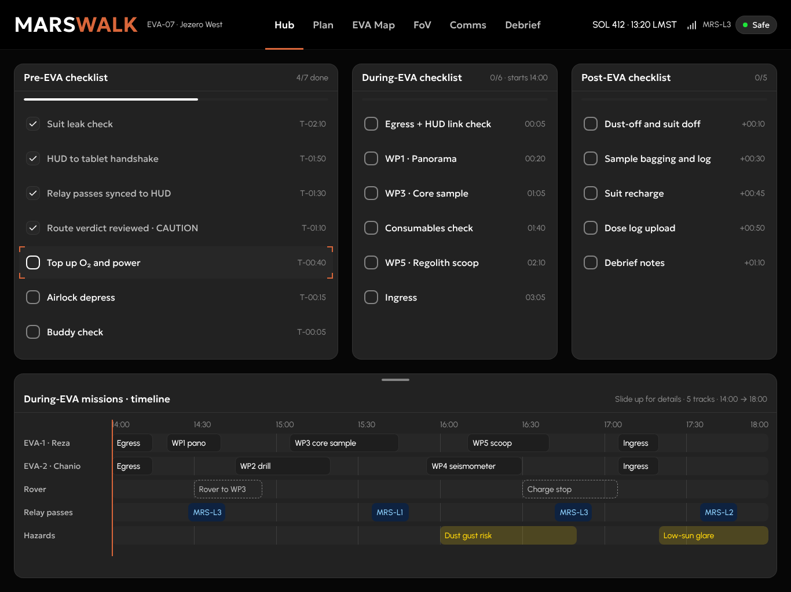
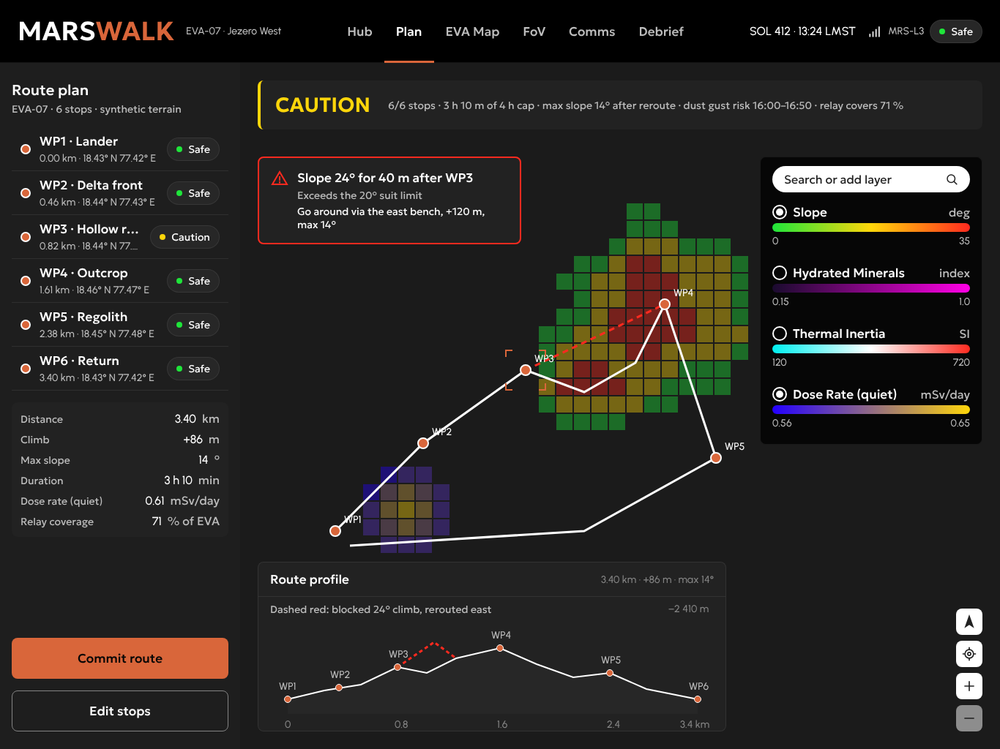
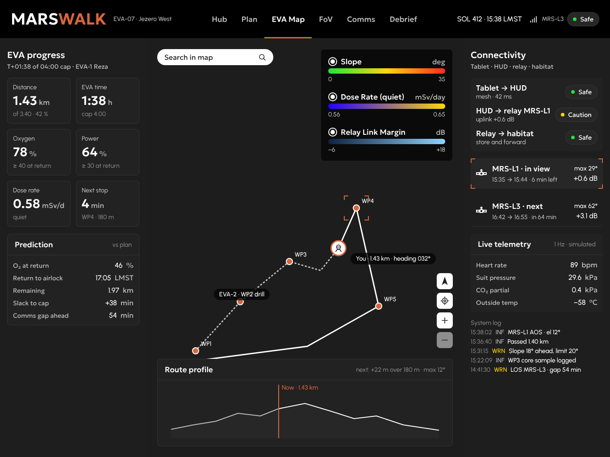
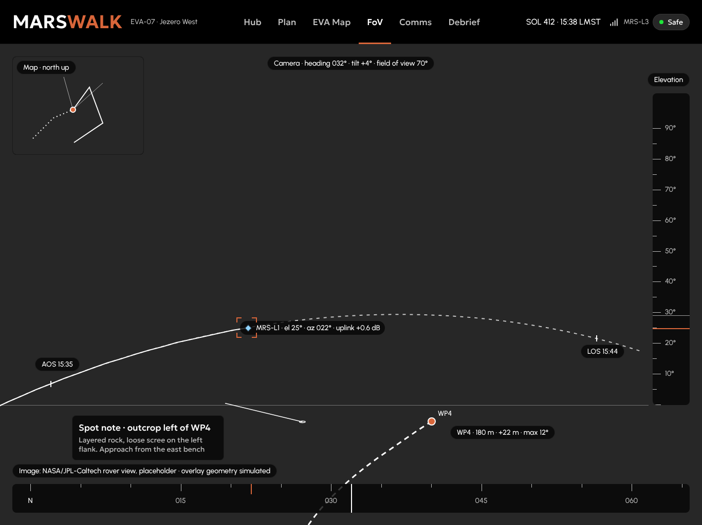
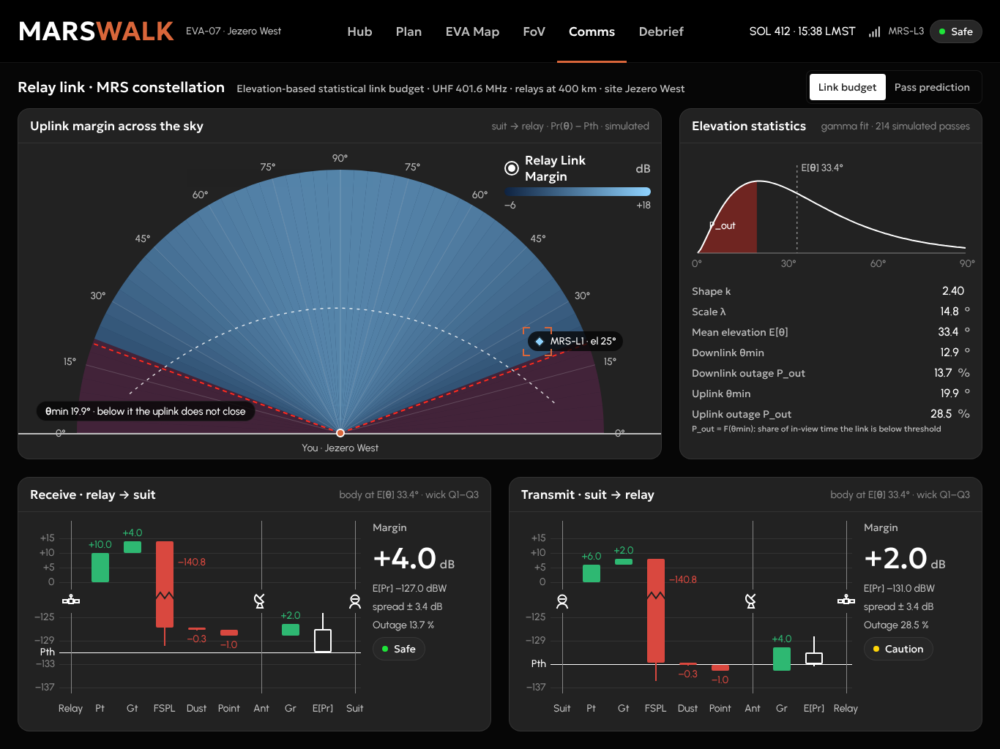
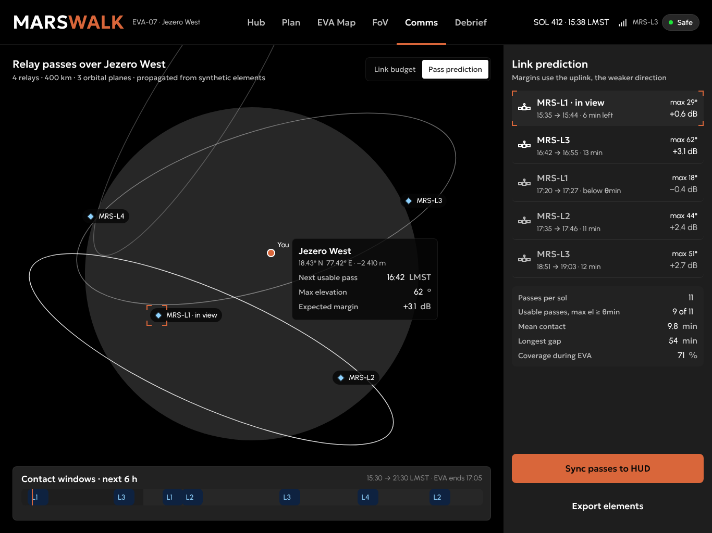
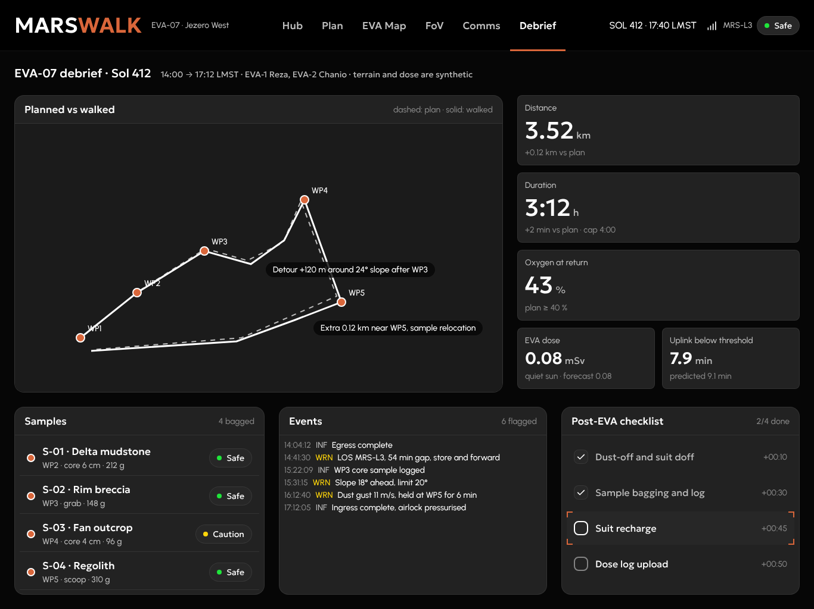

# Marswalk

Front-end for **Marswalk**, a single-EVA (Marswalk) planner built for NASA Space Apps Jakarta, challenge "Interplanetary Survival Guide: Martian Map".

This is the web app for the "Marswalk v1 · iPad screens" in the Figma file *Marswalk - Palatine*. It is a front-end prototype: every number on screen is synthetic or modelled (see [Data honesty](#data-honesty)).

## Screenshots

Captured from the production build at 1366 × 1024. The map, camera and globe areas are plain grey because the three placeholder images are not in the repository yet (see [Add the images first](#add-the-images-first)). Screens after the science-engine integration: [docs/INTEGRATION.md](docs/INTEGRATION.md#screenshots-figma-prototype-before-vs-integrated-after-1366--1024).

| | |
| --- | --- |
| **01 · Mission Hub**<br> | **02 · Route Planner**<br> |
| **03 · EVA Map**<br> | **04 · FoV Simulation**<br> |
| **05 · Comms · Link Budget**<br> | **06 · Comms · Pass Prediction**<br> |
| **07 · Debrief**<br> | |

## Run it

```bash
npm install
npm run dev        # http://localhost:5173
npm run build      # type-check + production build in dist/
npm run preview    # serve the production build
```

Requires Node 20 or newer. The build uses a relative base path, so `dist/` can be hosted from any folder (for example GitHub Pages).

## Add the images first

The Figma screens use three raster placeholders. They are **not in this repository** yet; export them from Figma and save them here:

| File | Figma layer | Used on |
| --- | --- | --- |
| `public/images/mars-globe.png` | "Mars globe (placeholder image)" | Comms · Pass prediction |

Plan, EVA Map, FoV and Debrief now use the real HiRISE orthoimage and DTM in `public/data/terrain/`, so
`mars-basemap.jpg` and `fov-camera.jpg` are no longer needed.

Until they exist, each slot shows a neutral surface and a status line naming the missing file. Check the license and credit of each image before the submission; the design marks all three as placeholders to be replaced with real NASA imagery.

## Screens

| Route | Figma frame |
| --- | --- |
| `#/hub` | 01 · Mission Hub (Pre-EVA) |
| `#/plan` | 02 · Route Planner (Pre-EVA) |
| `#/eva` | 03 · EVA Map (During EVA) |
| `#/fov` | 04 · FoV Simulation (During EVA) |
| `#/comms` | 05 · Comms · Link Budget |
| `#/comms/passes` | 06 · Comms · Pass Prediction |
| `#/debrief` | 07 · Debrief (Post-EVA) |

The app renders a fixed 1366 × 1024 stage (iPad Pro 12.9" landscape) and scales it to fit the window.

## Stack

- Vite, React 19, TypeScript (strict)
- Tailwind CSS v4, with the Marswalk tokens declared in `src/index.css`
- shadcn/ui conventions (`components.json`, `src/components/ui`, `cn`, `cva`, Radix primitives): Button, Badge, Card, Checkbox, Dialog, Input, ToggleGroup, all restyled with Marswalk tokens
- Geologica and Urbanist, bundled through Fontsource so the app works offline

## Structure

```
src/
  index.css               design tokens (colors, spacing, radius, type styles, ramps)
  styles/motion.css       motion tokens and every animation pattern
  lib/                    motion helpers, hash router, session store
  data/mission.ts         all demo data (synthetic), one place to swap for real data
  components/ui/          shadcn-style primitives
  components/marswalk/    product components (top bar, checklist, map, alerts, comms...)
  screens/                one file per Figma screen
```

Design rules come from two project documents: `DESIGN.md` (look) and `DESIGN-MOTION.md` (movement). Components use semantic tokens only; durations and easings live in `motion.css` and are read from CSS variables in JS.

## Motion

Stepped, frame-snapped motion in 50 ms ticks. The map camera is the only smooth movement.

| Pattern (DESIGN-MOTION.md) | Where |
| --- | --- |
| Flash-in, staggered in reading order | rows, tiles, timeline bars, candles, panels |
| Header wipe | every panel header |
| Lock-on open | site panel on Pass prediction (tap the "You" marker) |
| Hover underline then fill, press inversion | buttons and nav tabs |
| Hold to confirm | "Commit route" (keyboard users get a confirm dialog) |
| Text decode | screen headings and status lines |
| Stepped readout ticker | stat rows and metric tiles when a value changes (heart rate on EVA Map) |
| Layer scan reveal | layer toggles on Plan, sky-dome wedges |
| Route draw | planned and walked routes, elevation profiles |
| Hazard interrupt | hazard alert and the blocked segment, readable on frame one |
| Verdict stamp | verdict banner on Plan |
| Screen change | six columns between views, top bar stays put |
| Status line (toast) | commit, sync, missing images |
| Selection brackets | active checklist step, selected waypoint, relay in view |

Reduced motion: with the OS setting, or `?motion=reduced` in the URL, every sequence becomes a single 100 ms fade.

Not built yet: directional ticks, pixel-stair loader, and the in-app reduced-motion switch.

## Science engine

Routes, oxygen, dose, weather, walk-back and the GO / CAUTION / NO-GO verdict are computed by the Marswalk science
engine in `src/engine/` on real Jezero data (HiRISE DTM and orthoimage, MEDA weather, Perseverance stops) in
`public/data/`. Typed adapters in `src/sim/` feed the screens. See [docs/INTEGRATION.md](docs/INTEGRATION.md) and
[docs/SCIENCE_PROVENANCE.md](docs/SCIENCE_PROVENANCE.md).

```bash
npm test           # engine tests + regression and integration tests
```

## Data honesty

Terrain, MEDA temperatures and pressure, and stop positions are measurements. Routes, slope and sky view are calculated
from them; oxygen and dose are modelled; suit and mission-rule values are assumed and switchable (Plan screen, "not yet
agreed"). The EVA walk, debrief "measured" values, heart rate, relay passes, link budget, minerals and thermal layers
are simulated or synthetic, and the screens say so. Routes are "planned", and the verdict is a planning aid.

## Known differences from the Figma frames

- The Pre-EVA header counts completed steps from state, so it reads "4/7 done" where the frame says "5/7 done" with four boxes ticked.
- Comms has a small "Link budget / Pass prediction" switch, because the two Comms frames share one tab.
- The Dose layer draws a small synthetic patch on the planner; the frame shows the toggle on with no cells.
- "Live telemetry" is labelled "1 Hz · simulated" and the sky dome header ends with "simulated".
- Routes, charts and the sky dome are drawn from data in code instead of static images, so they can animate and later take real data.
