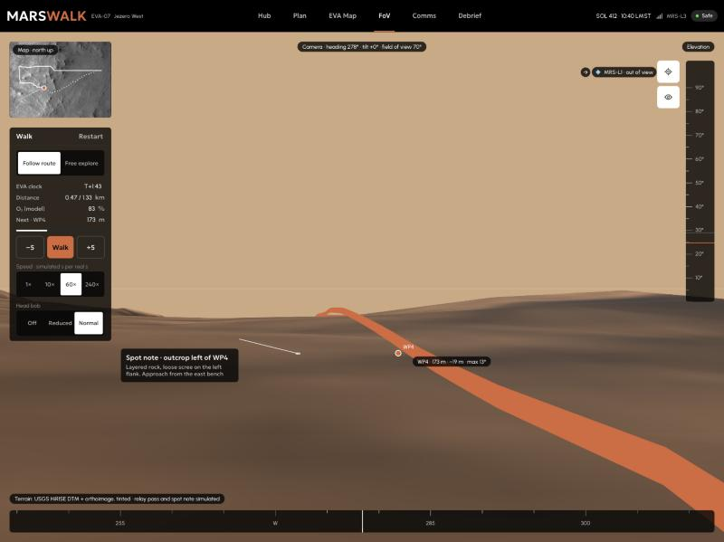
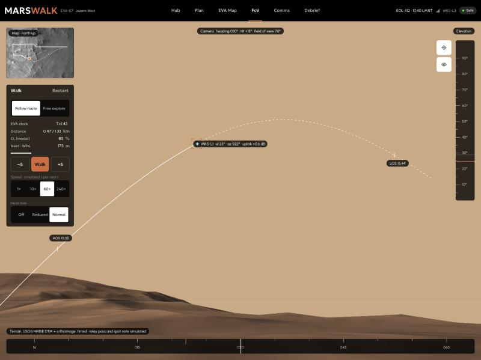

# FoV walking: route-following, free look, Free Explore

The FoV screen (`#/fov`) is the desktop/tablet first-person **simulation** of the planned EVA. This page covers how
it moves, how the camera is built, and the seam a later Android/iOS AR app plugs into.

| Follow route, next waypoint WP4 | Looking up at the relay pass (heading 030°, tilt +18°) |
| --- | --- |
|  |  |

## Layout

Built from the FoV design's parts and the brand rules in DESIGN.md (scrim panels with a hairline border, 16 px inside,
`label-m` titles, stat rows, white map-control squares, glove-size targets), with everything anchored to the screen
edges so wide and tall screens both work:

- **Top left**: minimap ("Map · north up"; walked dotted, ahead solid, view cone), then the **Walk** panel: mode,
  EVA clock, distance, O₂, next stop, progress, −5 / Walk / +5, speed, head bob, Restart in the header. Free explore
  swaps the clock rows for "Off the plan" and explored distance.
- **Top centre**: "Camera · heading · tilt · field of view 70°".
- **Right**: Elevation ruler; beside it the map controls **Reset view** and **Mouse look** (desktop).
- **Bottom**: source credit and the azimuth ruler (heading at the centre, satellite tick, walking tick); in Free
  explore the walk pad (map-control squares, centre square = ×10 fast) sits above the ruler on the right.
- **In the scene**, projected through the 3D camera every frame so they stay fixed in the world: the relay pass
  (flown solid, predicted dashed) with the MRS-L1 satellite marker and brackets, AOS / LOS, the 0° horizon, the
  next-waypoint marker and tag ("WP4 · 173 m · −19 m · max 13°"), and the spot note at WP4. When the satellite is out
  of view its marker is pinned to the screen edge with an arrow pointing to it.

The 3D camera has a 70° horizontal field of view, so the azimuth ruler spacing matches the view. The pass, its times and
the spot note are the design's simulated values.

## Controls

| | Desktop | Tablet / phone |
| --- | --- | --- |
| Look around (head) | Drag on the view, or **Mouse look** (pointer lock, Esc releases), or arrow keys | Drag on the view |
| Reset view | **Reset view** eases the head back to the walking direction | same |
| More | Restart, −5 / +5 min, speed, head bob, Mouse look | same |
| Follow route | **Walk / Pause**, **Restart**, **−5 / +5 min**, speed **1× 10× 60× 240×** (simulated s per real s) | same, 56 px glove targets |
| Free explore | W A S D, Shift = fast (12 m/s fly-over) | press-and-hold arrow pad, **Fast** toggle |
| Head bob | **Off / Reduced / Normal**; defaults to Off with reduced motion | same |

## Two modes

**Follow route.** Progress is the mission clock T, exactly as in the original `MARSWALK/app` `stepWalk()`:
`T += dt × rate / 60`, then the engine's `sampleAt(prof, T)` gives the position on the computed route. The position,
O₂, dose and waypoint state therefore come from the same sample the science engine uses, and the clock is the one
EVA Map, Hub and Comms read (synced at 4 Hz). If EVA Map was playing when you open FoV, FoV takes over the walk and
hands it back when you leave. The walker never makes up geometry: the tests check that every frame lies on the
route polyline, that all waypoints are passed in order, and that O₂ equals the engine's at that clock.

**Free explore.** Walk anywhere on the HiRISE patch (kept 15 m inside the mesh edge). The mission clock is
held, nothing is written to the plan or to consumables, and the screen says so in caution colour.

## Camera architecture (AR-ready)

| Layer | File | Knows about |
| --- | --- | --- |
| 1 World / terrain | `src/sim/fov/world.ts` | engine frame (x east, y up, z south), DTM height, bounds |
| 2 Astronaut route position | `src/sim/fov/route-walker.ts` | engine profile + clock → sample, walking heading, pace |
| 2b Free explore | `src/sim/fov/explore.ts` | move intent → position on the terrain |
| 3 Camera pose | `src/sim/fov/camera-rig.ts` `composeCamera` | body + head look → `CameraPose` |
| 4 Camera effects | `src/sim/fov/camera-rig.ts` `stepBob` | head bob (presentation only) |
| 5 Input | `src/sim/fov/input.ts` | drag, pointer lock, keys, pad |
| 6 Mission telemetry | engine `sampleAt` / `status`, `src/sim/view.ts` `nextArrival` | the plan and the clock only |
| Renderer | `src/sim/terrain-view.tsx` | a `CameraPose`; nothing else |
| AR seam | `src/sim/fov/pose-source.ts` | `CameraPoseSource`, `WorldCalibration`, `progressCounts()` |

Walking heading (body) and camera yaw (head) are separate: camera yaw = walking heading + look yaw. Looking
backward or sideways never changes route progress or the walking direction. Head bob moves the eye by at most
2.8 cm vertically and 1.2 cm sideways, scales with the astronaut's walking pace, eases in and out, fades to zero
when standing, and has no roll. Its cadence runs in real time, so 60× playback does not become a 60× shake.

### Phase 4 (Android/iOS AR), not started

In AR the pose comes from ARCore / ARKit 6DoF tracking: the user walks and turns the phone. There is **no**
joystick, D-pad, simulated rotation or head bob in AR; those exist only in this desktop simulation. A device
`CameraPoseSource` maps the session frame onto the mission frame through a `WorldCalibration`, and
`progressCounts()` only lets physical movement count as route progress when tracking is `normal` and the
calibration residual is within 2 m. Otherwise the app must warn and keep the committed route unchanged.

## Performance (measured, MacBook Air M1, Chrome, 1366×1024)

- Ground height: a raycast on the 83,580-triangle mesh costs **~6.5 ms**; FoV instead samples the engine DTM grid
  (bilinear, 4 m cells), which matches the mesh to **±0.13 m**. The route tube uses the same heights, so building it
  no longer raycasts per route point.
- Frame times while walking in Free explore: **p50 16.7 ms, p95 17.6 ms** (60 fps).
- One render per changed pose; a paused, still view stops drawing. HUD numbers update at ~15 Hz, the shared clock at
  4 Hz, so the React tree does not re-render every frame.
- Pixel ratio capped at 2. WebGL context loss pauses the view with a message and resumes on restore; missing WebGL
  or a missing terrain file shows a message instead of a blank screen. GPU resources are disposed on leave.
- FoV chunk 72 kB (three.js stays in its own lazy chunk).

## Known limitations

- Each frame is capped at 0.1 s so a stall never becomes a jump; in a throttled background tab the walk slows instead.
- No pinch-zoom or field-of-view control; horizontal FoV fixed at 70°.
- At 25° elevation the satellite sits above a 16:9 view when looking level; tilt up (or follow the edge marker) to see it.
- Free explore has no collision with boulders (the DTM is the only obstacle model) and ignores slope limits.
- The relay elevation ruler is still the simulated pass from the design.
