# Science engine integration (Phase 2)

This branch turns the v1 front-end from a synthetic-data prototype into a planner driven by the Marswalk science engine.
The design system, components, layout and motion are the leader's and are unchanged except where noted below.
Assumptions and data sources: [`SCIENCE_PROVENANCE.md`](SCIENCE_PROVENANCE.md).

## Architecture

```
public/data/                     real data, copied from MARSWALK/data
  app/app.json, app/grid.bin     5 Perseverance stops; 4 m grid: elevation, slope, sky view, roughness (HiRISE DTM)
  meda_weather.json              MEDA hourly medians at the stops
  terrain/ortho.jpg, terrain_draco.glb   HiRISE orthoimage and 3D mesh
        │
        ▼
src/engine/   (plain ESM JavaScript, no DOM, ported unchanged from MARSWALK/app, typed by index.d.ts)
  telemetry.js  route.js  models/{energy,oxygen,cost,risk,returnfield,evaluate,lookup,surrogate}.js
  debrief.js  sync/{channel,plan}.js
  + profiles.js   science vs policy profiles (explicit, switchable)
  + mission.js    planMission(): return field + three route modes + GO / CAUTION / NO-GO
  + playback.js   sampleAt(), walkBackMargin()  (moved from MARSWALK main.js, now pure)
  test.mjs (original tests) · integration.test.mjs (regression + profiles + playback)
        │
        ▼
src/sim/      typed adapters between engine results and the UI
  load.ts         fetch + validate data files
  mission.tsx     MissionProvider: settings, planning (~1 s, off the first paint), EVA clock, light-time link
  view.ts         engine units → design-pixel view models and display strings (projection, layers, plan, EVA)
  controls.tsx, status-strip.tsx, link-card.tsx, terrain-view.tsx (three.js)
        │
        ▼
src/screens/  the leader's screens, now reading view models instead of src/data/mission.ts
```

`marswalk-model` remains an offline cost provider: `planner_lookup_mars.json` can be validated by
`src/engine/models/lookup.js`, but it is **not loaded** (see SCIENCE_PROVENANCE.md, "Not active").

## Screen by screen

| Screen | Now computed | Still synthetic / placeholder (labelled on screen) |
| --- | --- | --- |
| Hub | Status strip: verdict, EVA window (LMST), duration vs cap, distance, O₂ at return, walk-back margin, rules in force | Crew timeline (two-person schedule); checklists are the team sheet, unchanged |
| Plan | Route (A*), waypoints at real stops, verdict + reasons, steep-stretch hazard card, slope and dose layers, elevation profile, summary; mode, rules, suit and start-time controls; Commit sends the plan over the link | Hydrated-minerals and thermal-inertia layers; "Edit stops" |
| EVA Map | Simulated walk on the plan (Play, ±10 min): position, tiles, prediction, profile, no-return ring, cells over the slope limit, log, MEDA temperatures/pressure, O₂ rate, dose rate | Heart rate, power, connectivity hops, relay passes, relay-link layer |
| FoV | three.js walk along the computed route on the shared EVA clock (delta-time, 1–240×, pause/restart), free look independent of walking direction, head bob, Free explore off-plan; minimap, look/walk headings, next-stop tag, O₂ and progress. See [FOV_WALKING.md](FOV_WALKING.md) | Relay elevation ruler |
| Comms | Mission-control link card: light-time delay presets, Send plan, message log (engine `createLink`) | Link budget and pass prediction: the leader's UI and values, unchanged |
| Debrief | Plan outcome, per-leg walking O₂ predicted vs simulated playback, calibrated k_suit (Apply → next plan), EVA dose, events from the plan | "Measured" values are a seeded simulation (no suit telemetry); samples list; no walked GPS track |

`src/data/mission.ts` is still used for the synthetic items in the right-hand column above.

## Validation

- `npm test`: original engine tests (unchanged numbers) + integration tests. **All pass.**
  - Regression: with the default profiles, `planMission()` gives byte-identical O₂, distance, dose, walk-back margin and
    Q to the original `main.js` call path for all three modes; golden values 1.33 km, 126.6 L, 217 min, 0.106 mSv.
  - Profiles: SUIT is never mutated; 40 kg suit uses less O₂; hold-sheet routes stay under 16°.
  - Units: O₂ budget closes (used + left = tank); EVA dose is in mSv.
  - Playback: O₂ monotonic, ends at the plan total; `status()` and walk-back margin work on samples.
- Side-by-side with the original app: the ported `test.mjs` output matches `MARSWALK/app` line for line except timings and
  the lookup end-to-end check (needs the generated `rough_m.bin`, deliberately not committed).
- `npm run build` (tsc strict + Vite): passes; CI runs typecheck, tests and build on every PR (`.github/workflows/ci.yml`).
- Browser (1366 × 1024 and 768 × 1024): no console errors on any screen; no horizontal scroll at 768 px.
  Workflow checked: Plan 126.6 L → switch to hold-sheet rules 128.3 L / 4 h cap → Debrief "Apply k_suit 1.135" →
  Plan 132.0 L.
- Glove targets: all new controls are 56 px. Map buttons and layer switches were raised to 56 px. Remaining smaller
  controls are listed under issues.

## Screenshots: Figma prototype (before) vs integrated (after), 1366 × 1024

The "before" images are the leader's captures of the v1 build of the Figma frames (`docs/screenshots/`).

| Screen | Before (v1, Figma data) | After (engine data) |
| --- | --- | --- |
| Hub | 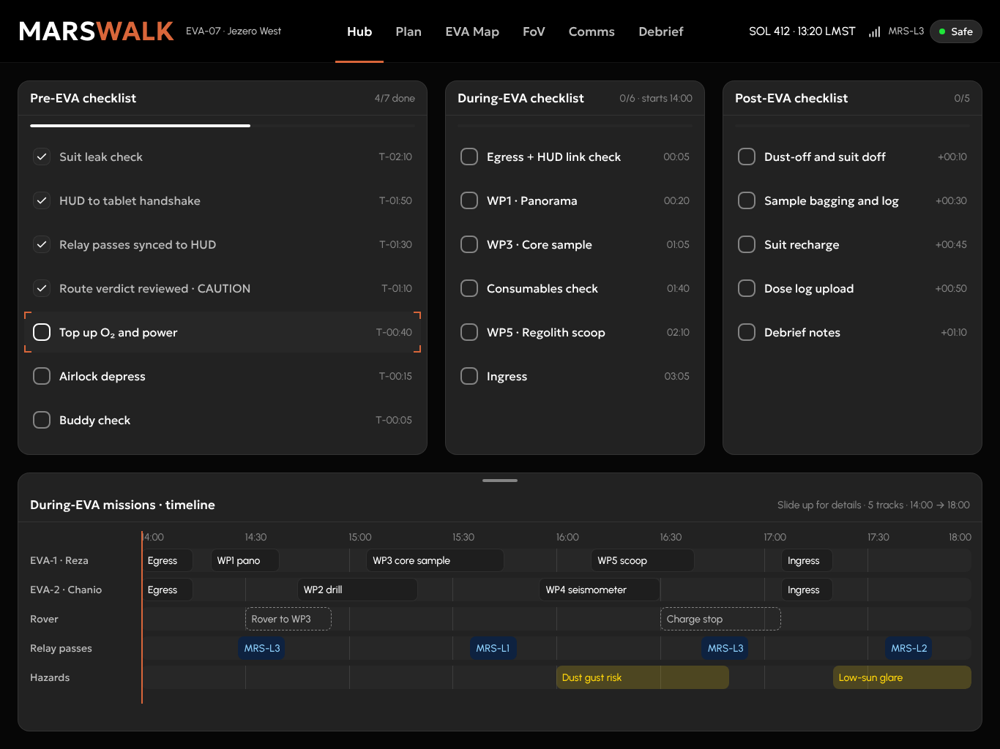 | 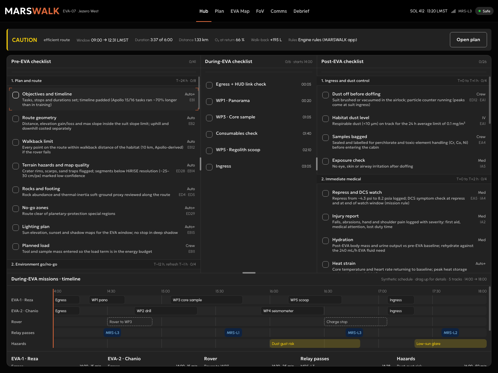 |
| Plan | 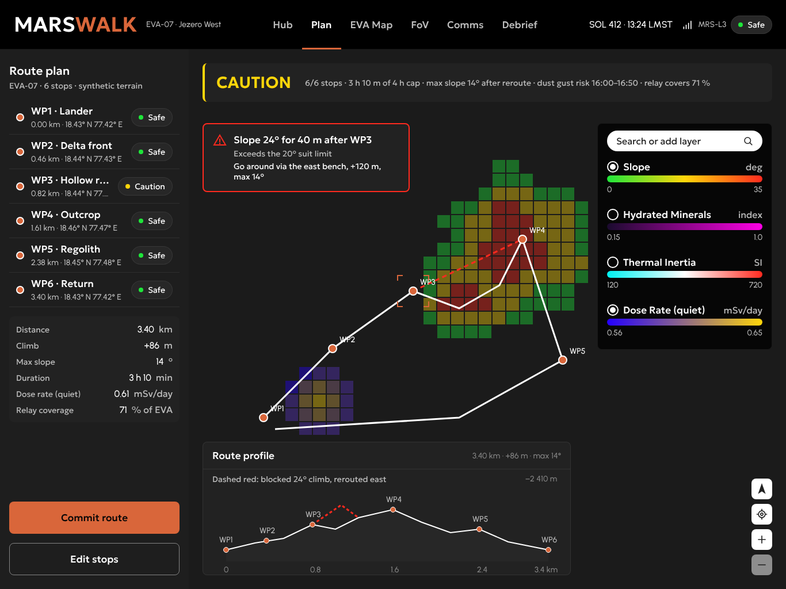 | 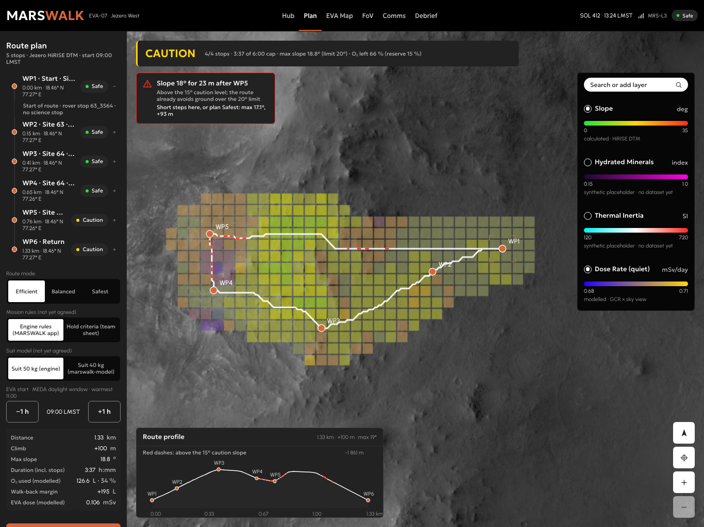 |
| EVA Map | 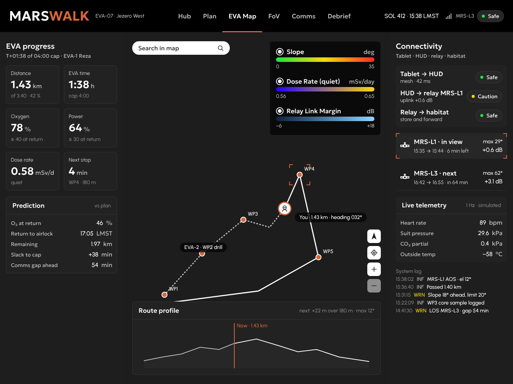 | 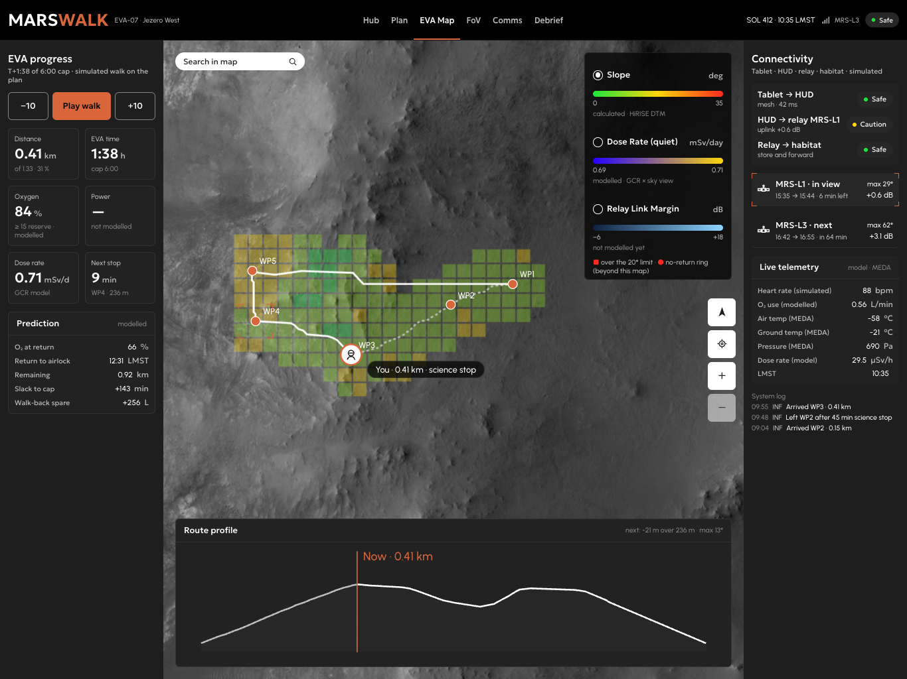 |
| FoV | 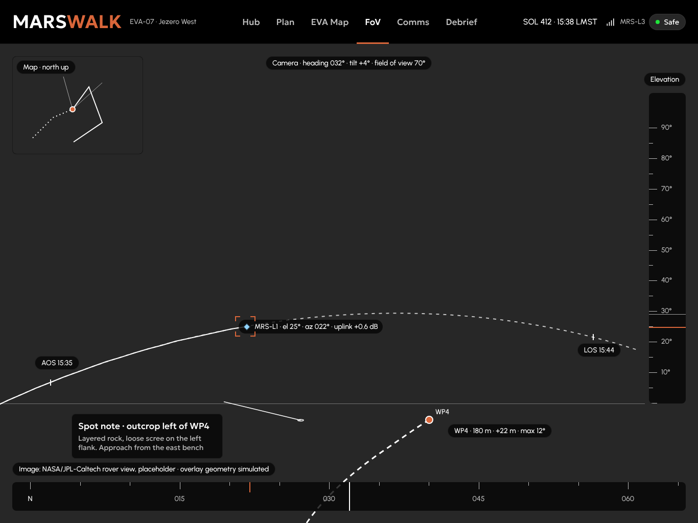 | 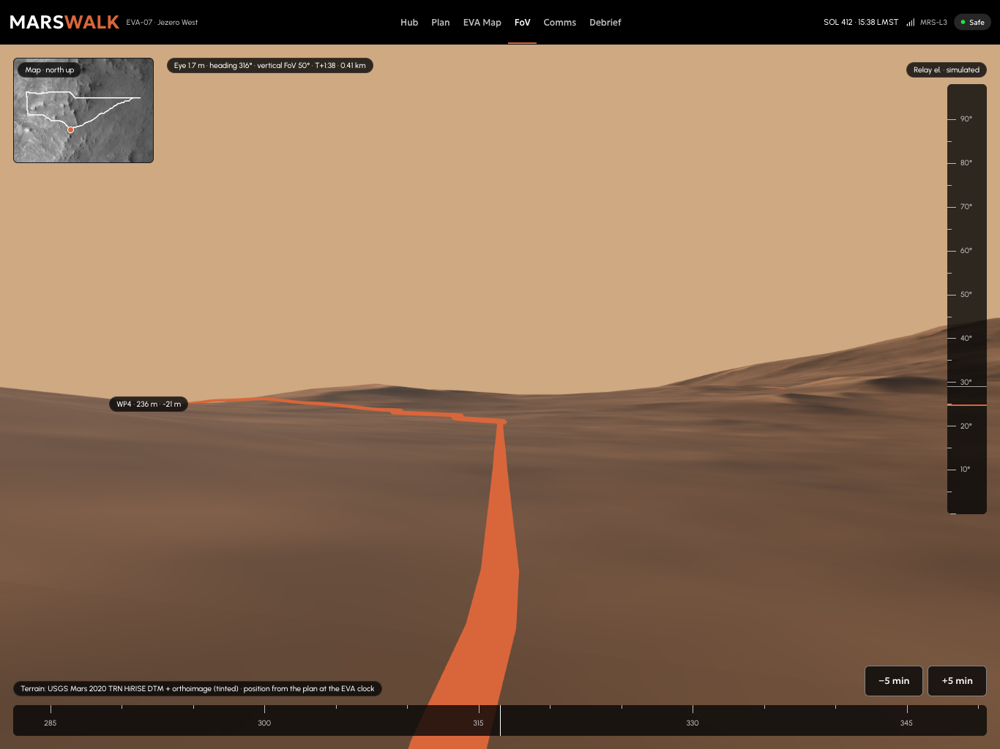 |
| Comms | 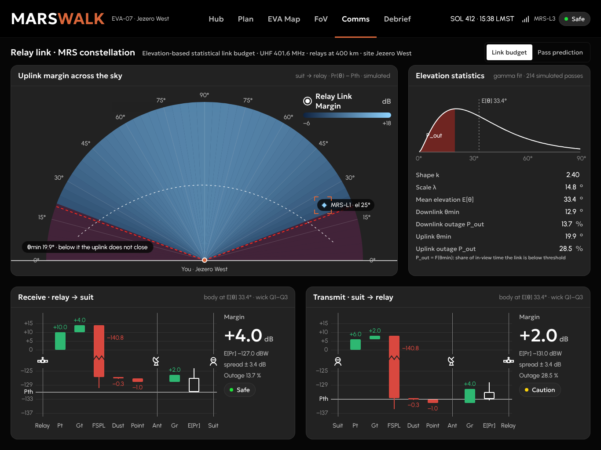 | 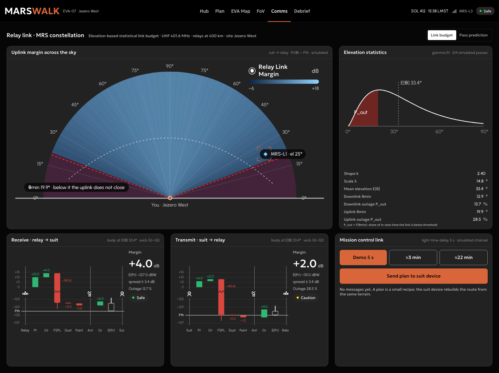 |
| Debrief | 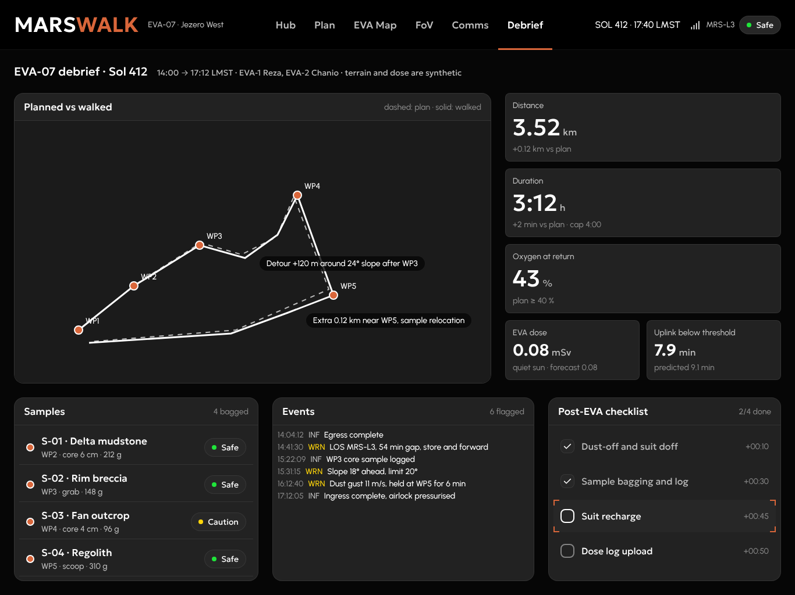 | 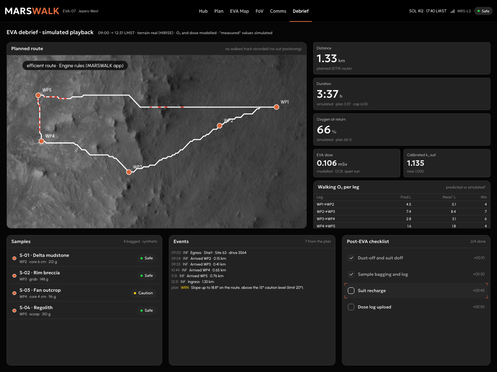 |

## Unresolved issues

1. **Rules and suit mass are not agreed.** Slope 16° vs 20°, O₂ reserve 40 % vs 15 %, EVA cap 4 h vs 6 h, distance vs
   O₂ walk-back, suit 40 vs 50 kg. Both profiles ship; the defaults reproduce the original engine. The leader picks.
2. **Hold-sheet values with no source in the sheet**: caution slope and reserve factor reuse engine values.
3. **marswalk-model lookup stays off** (roughness domain, suit mass, walker validation).
4. **No walked track or suit telemetry.** EVA Map and Debrief use a simulated walk on the plan; Debrief "measured" values
   are seeded. Heart rate, power, CO₂ are not modelled.
5. **Comms data is still synthetic** (gamma fit constants, pass list, link budget). No pass-prediction model exists in
   the engine.
6. **The link has no astronaut side in this app.** `createLink` uses BroadcastChannel, which is same-origin, so the old
   `MARSWALK/app ?role=astronaut` page on another port cannot receive. A suit-device view is a follow-up.
7. **Two-person crew**: the design shows EVA-1 and EVA-2; the engine plans one walker.
8. **Minerals / thermal layers**: synthetic patches until CRISM and THEMIS data are added on the 4 m grid.
9. **Top bar**: the LMST clock now follows the plan; EVA-07, Sol 412, MRS-L3 and the "Safe" link chip are still static scenario labels.
10. **Glove targets below 56 px in existing components**: Comms "Link budget / Pass prediction" toggle (36 px),
    search inputs, checklist checkboxes (the row is the target). Not changed, to avoid redesigning leader components.
11. **Bundle size**: FoV is lazy-loaded; main chunk 502 kB (161 kB gzip), three.js chunk 569 kB loads with FoV only. Vite still warns about the three.js chunk.
12. **Data size**: `public/data` adds 7.9 MB (grid 4.2 MB, mesh 3.3 MB, ortho 0.8 MB) and `public/draco` 0.75 MB; see RELEASE_READINESS.md §6.
13. Planning runs on the main thread (~1 s on profile change); a Web Worker would keep the UI responsive.
14. **`public/images/mars-globe.png` is still missing** (Comms · Pass prediction). It was missing before this branch; the
    slot shows a neutral surface and a toast. The `Basemap` component (placeholder texture) is now unused.
